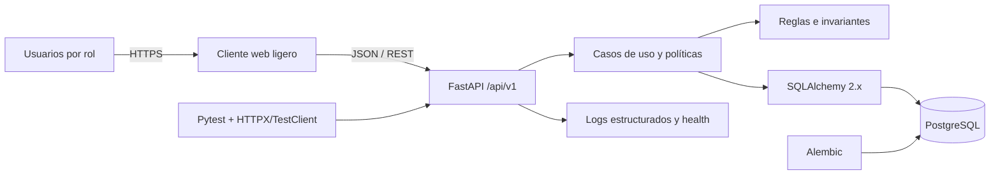
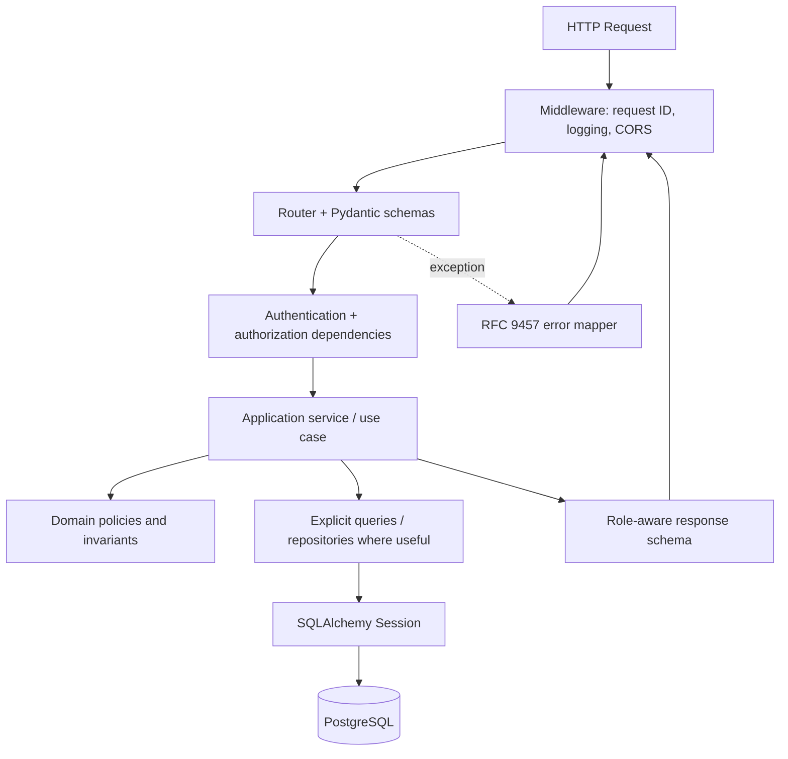
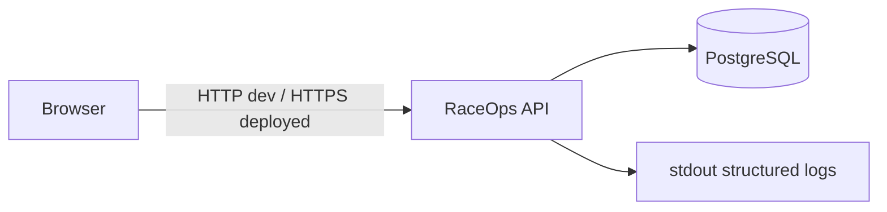

# RaceOps — Arquitectura general

## 1. Información del documento

- **Versión:** 1.0
- **Estado:** Preparado para Gate G4
- **Estilo:** Monolito modular, API-first, backend-first

## 2. Vista de contexto

El cliente web no contiene reglas de autorización confiables. Toda decisión
de seguridad se repite en el servidor.

## 3. Vista interna

## 4. Flujo de escritura

1. Middleware asigna `request_id`.
2. El router valida sintaxis con Pydantic.
3. Autenticación resuelve User, TeamMembership y Role.
4. El servicio de aplicación carga recursos dentro del Team.
5. Las políticas verifican permisos, estado e invariantes.
6. La operación completa ocurre dentro de una transacción corta.
7. SQLAlchemy hace flush y PostgreSQL protege constraints.
8. El servicio confirma o revierte la transacción.
9. Un schema de salida autorizado filtra campos.
10. El log registra resultado sin contenido sensible.

## 5. Flujo de lectura

1. Se autentica y determina Team.
2. La consulta incluye ownership y restricciones de visibilidad.
3. El filtrado ocurre antes de conteo y paginación.
4. La proyección recupera sólo campos necesarios.
5. El schema de salida aplica la última defensa por campo.

## 6. Despliegue inicial

En desarrollo, API y PostgreSQL se ejecutarán mediante Docker Compose. No
se agregan Redis, broker, workers, microservicios ni Kubernetes sin una
necesidad observada.

## 7. Referencias técnicas oficiales

- [FastAPI — Bigger Applications](https://fastapi.tiangolo.com/tutorial/bigger-applications/)
- [SQLAlchemy — Session Basics](https://docs.sqlalchemy.org/en/20/orm/session_basics.html)
- [Alembic — Tutorial](https://alembic.sqlalchemy.org/en/latest/tutorial.html)
- [RFC 9457 — Problem Details for HTTP APIs](https://www.rfc-editor.org/rfc/rfc9457.html)

