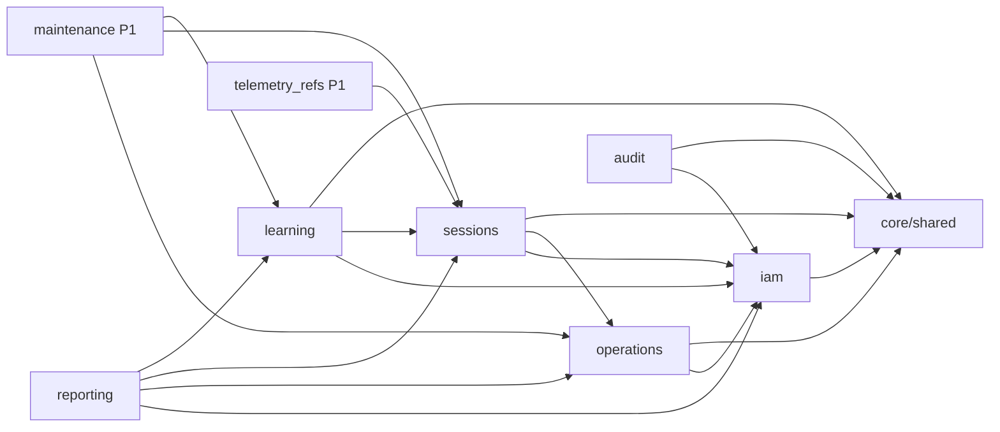

# RaceOps — Límites de módulos

## 1. Información del documento

- **Versión:** 1.0
- **Estado:** Preparado para Gate G4
- **Regla:** Módulos internos del mismo proceso, no microservicios

## 2. Módulos

### `iam`

Responsable de:

- User, Team y TeamMembership;
- autenticación;
- roles;
- contexto del actor;
- políticas base de ownership.

No conoce Sessions, Laps ni análisis.

### `operations`

Responsable de:

- Driver;
- Vehicle y disponibilidad básica;
- Track;
- Event.

Puede utilizar identidad del actor, pero no implementa autenticación.

### `sessions`

Responsable de:

- Session y sus estados;
- Results Status;
- Lap y Sector;
- Condition Snapshot;
- Driver Feedback.

Valida referencias de `operations` mediante interfaces o servicios
explícitos, no escribiendo directamente sus tablas.

### `learning`

Responsable de:

- Observation;
- Session Analysis;
- Hypothesis;
- Priority;
- Action;
- Action Outcome.

Depende de Sessions existentes, pero `sessions` no depende de `learning`.

### `reporting`

Responsable de:

- resúmenes de Session;
- cadena de aprendizaje;
- consultas históricas;
- proyecciones filtradas por rol.

Es principalmente de lectura. Puede consultar tablas de varios módulos sin
convertirse en propietario de ellas.

### `telemetry_refs` — P1

Responsable únicamente de referencias externas. No interpreta canales ni
archivos.

### `maintenance` — P1

Responsable de Maintenance Record y transiciones operativas autorizadas.
Depende de Vehicle y puede referenciar Session, Observation o Action.

### `audit`

Responsable de registrar eventos sensibles seleccionados:

- cambio de Role;
- bloqueo de resultados;
- corrección excepcional;
- cambio de Visibility;
- liberación de Vehicle.

No es event sourcing ni una copia de cada escritura.

## 3. Dependencias permitidas

Las flechas indican «puede depender de». No se permiten dependencias
inversas que produzcan ciclos.

## 4. Comunicación entre módulos

- Llamadas internas mediante servicios o interfaces Python explícitas.
- Una transacción puede abarcar módulos cuando un caso de uso lo requiere.
- No se usan HTTP interno, colas ni eventos distribuidos.
- Los módulos no hacen commit por su cuenta dentro de una operación mayor.
- Reporting utiliza consultas explícitas optimizadas y DTO de lectura.
- Audit recibe hechos relevantes después de que la política autoriza la
  operación, dentro de la misma transacción cuando su pérdida sea crítica.

## 5. Reglas de importación

- `core` y `shared` no importan módulos de negocio.
- Un router importa servicios de su propio módulo.
- Un módulo consumidor no importa routers o schemas HTTP de otro módulo.
- SQLAlchemy models pueden compartir Base y tipos comunes.
- No existe un archivo global `utils.py` para lógica sin dueño.
- Una función compartida sólo pasa a `shared` cuando tiene al menos dos
  consumidores claros y semántica estable.

## 6. Repositories

No se implementará un `GenericRepository` universal.

Se crearán repositorios o query objects explícitos cuando:

- una consulta es compleja o reutilizada;
- una operación necesita locking;
- la persistencia debe ocultarse para probar una regla;
- reporting necesita una proyección especializada.

CRUD simple puede utilizar SQLAlchemy directamente dentro del servicio de
aplicación, manteniendo la sesión inyectada y las transacciones externas.

## 7. Ownership de tablas

| Módulo | Tablas propietarias propuestas |
|---|---|
| iam | teams, users, team_memberships |
| operations | drivers, vehicles, tracks, events |
| sessions | sessions, laps, sectors, condition_snapshots, driver_feedback |
| learning | observations, session_analyses, hypotheses, priorities, actions, action_outcomes |
| audit | audit_entries |
| telemetry_refs P1 | telemetry_references |
| maintenance P1 | maintenance_records |

Sólo el módulo propietario modifica directamente su tabla mediante lógica
normal de negocio.

