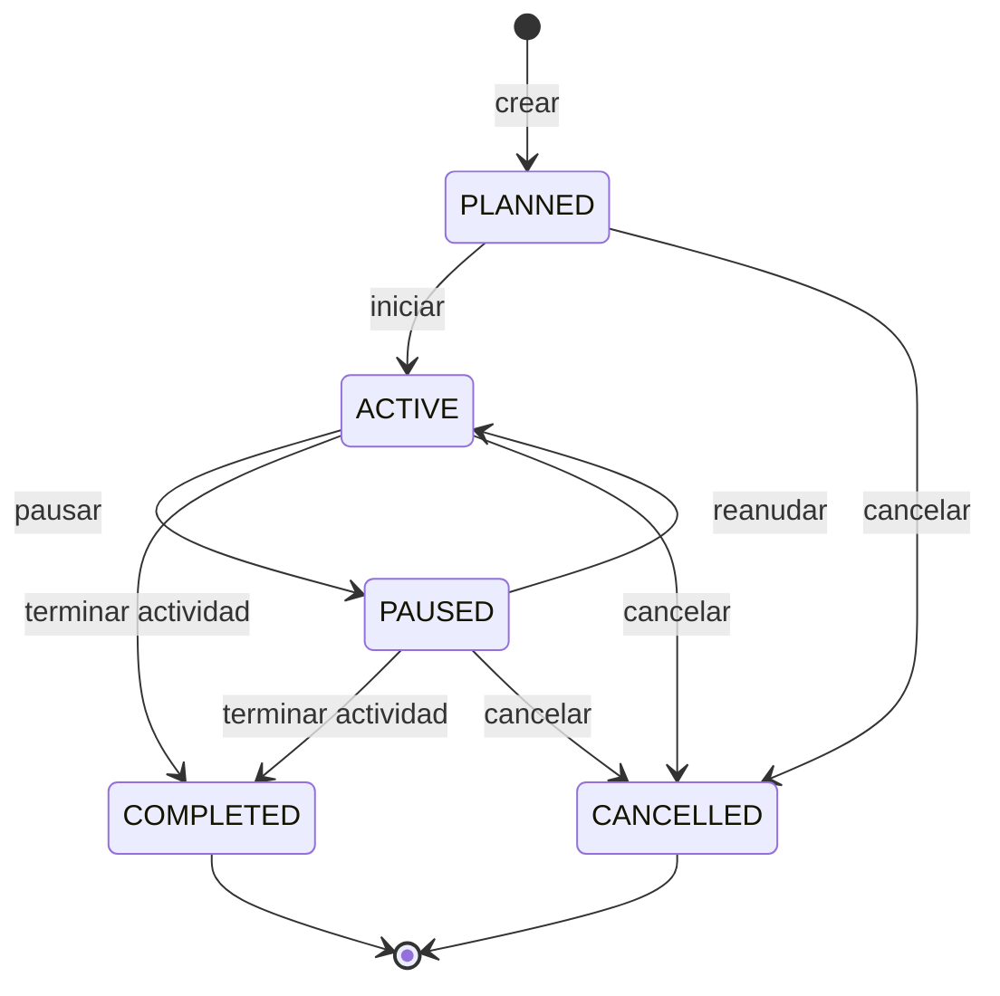
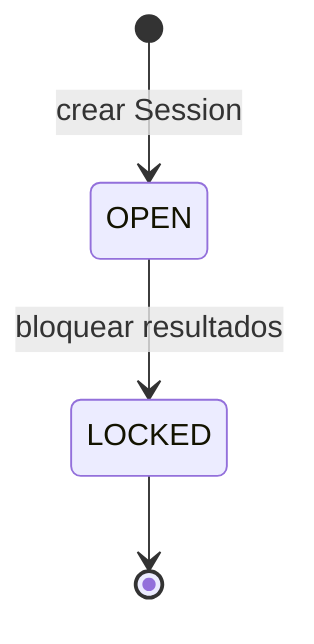
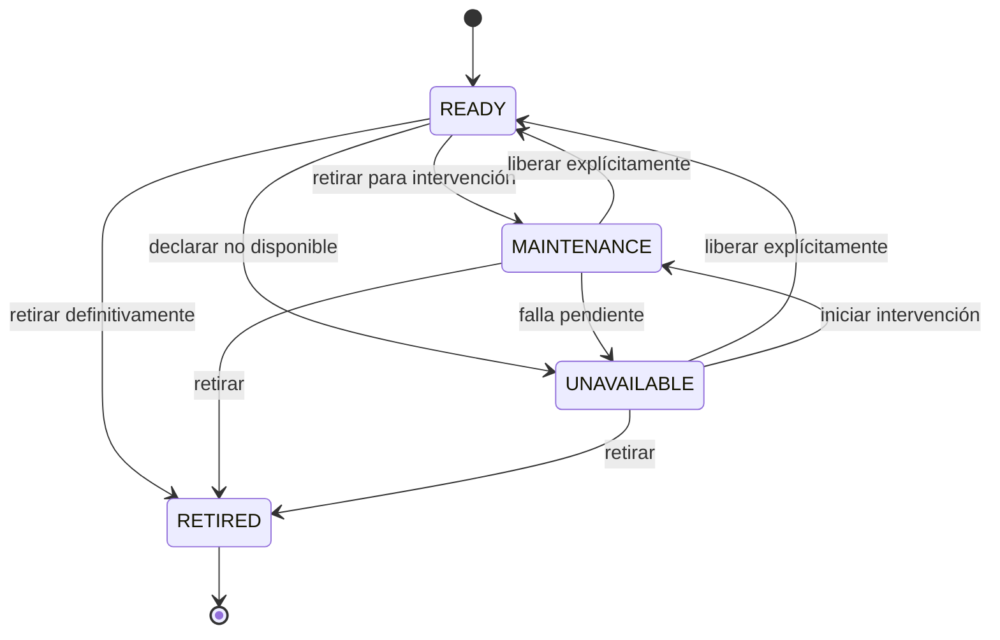
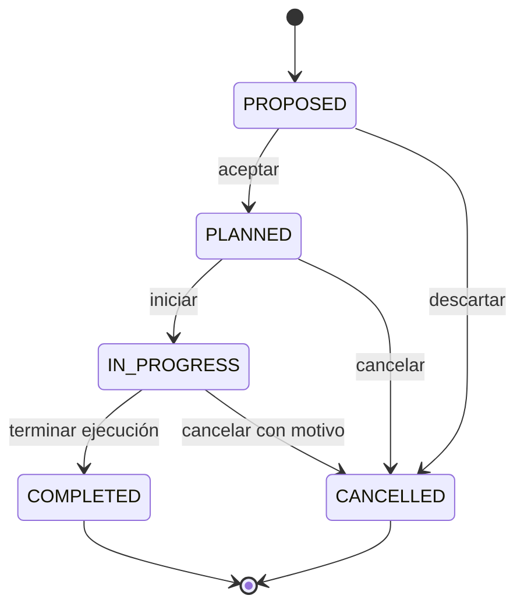
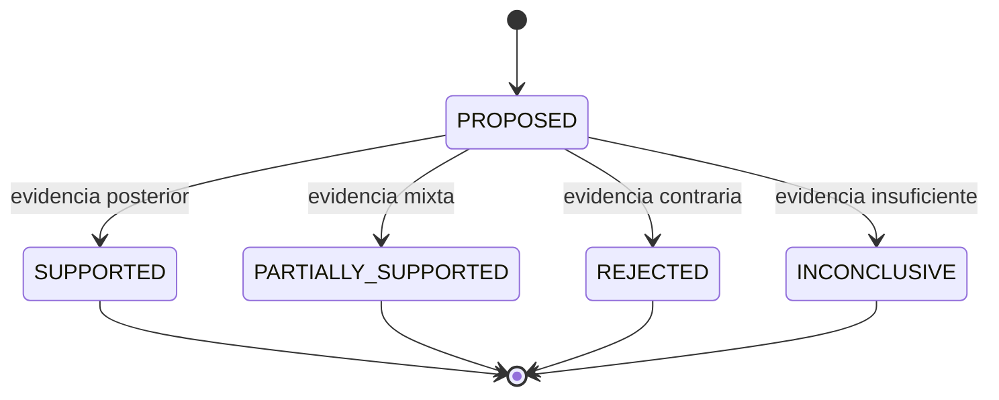
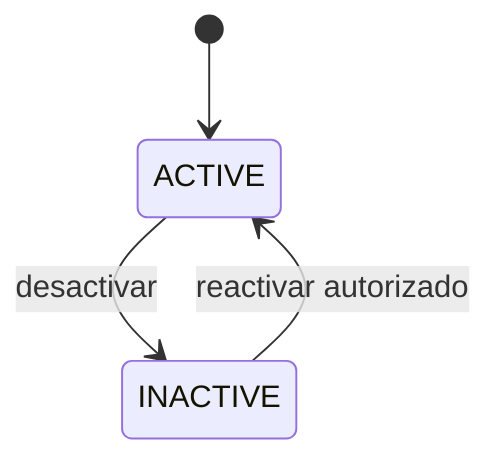
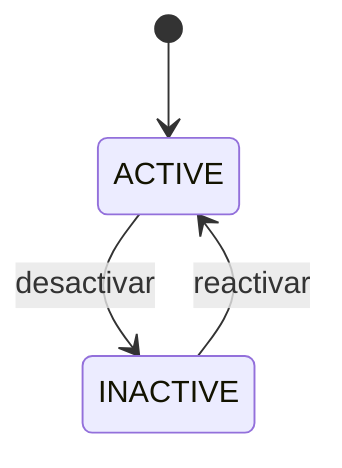

# RaceOps — Diagramas de estado

## 1. Información del documento

- **Versión:** 1.0
- **Estado:** Preparado para Gate G3
- **Propósito:** Definir transiciones normales y evitar estados ambiguos

## 2. Session Status

Reglas:

- sólo actores autorizados cambian el estado;
- `started_at` se fija al primer paso a `ACTIVE`;
- `ended_at` se fija al pasar a `COMPLETED` o `CANCELLED`;
- `COMPLETED` y `CANCELLED` no se reabren mediante el flujo normal;
- una corrección excepcional futura requiere autorización y auditoría.

## 3. Results Status

Reglas:

- el estado es independiente de Session Status;
- una Session `COMPLETED` puede conservar resultados `OPEN`;
- el bloqueo normal sólo ocurre después de `COMPLETED` o `CANCELLED`;
- `LOCKED` rechaza nuevas Laps y Sectors por el flujo normal;
- quien bloquea y cuándo quedan registrados;
- una corrección posterior es P1 y necesita motivo y permiso.

## 4. Vehicle Status

Reglas:

- sólo `READY` permite una nueva Session;
- terminar Maintenance Record no produce `READY` automáticamente;
- `RETIRED` es terminal mediante el flujo normal;
- las transiciones de mantenimiento son P1, mientras la validación de
  disponibilidad para asignación permanece P0.

## 5. Action Status

Reglas:

- el responsable o un coordinador autorizado actualiza ejecución;
- `COMPLETED` no crea automáticamente un Action Outcome;
- la evaluación puede permanecer `NOT_EVALUATED`.

## 6. Hypothesis Status

Una evaluación posterior adicional puede revisar un estado evaluado, pero
debe conservar la conclusión anterior y registrar nueva evidencia. La
implementación de revisiones completas puede permanecer P1; P0 conserva al
menos la evaluación vigente y su relación.

## 7. User y Membership

Desactivar acceso no elimina autoría histórica.

## 8. Driver

Un Driver inactivo conserva historia, pero no puede asignarse a una nueva
Session.

## 9. Estados que no deben combinarse

- Session Status no reemplaza Results Status.
- Action Status no reemplaza Action Outcome.
- Vehicle Status no se deriva automáticamente del último Maintenance Record.
- Hypothesis Status no se deriva automáticamente de una sola métrica.
